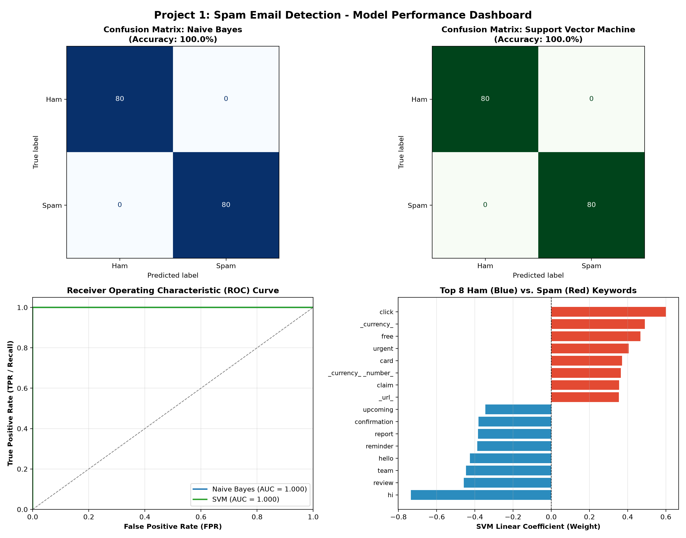

# 📧 Spam Email Detection & Classification

A machine learning system to detect and filter spam emails from raw email content using **Multinomial Naive Bayes** and **Support Vector Machines (SVM)** with TF-IDF n-gram vectorization.


---

## 📌 Project Overview
Unsolicited spam emails pose cybersecurity risks (phishing, malware, scams) and reduce user productivity. This project implements an NLP classification pipeline that:
1. Cleans and normalizes email text (handles URLs, email addresses, numbers, currency symbols, and casing).
2. Extracts unigram and bigram TF-IDF feature representations with sublinear term-frequency scaling.
3. Compares **Multinomial Naive Bayes** with **Linear Support Vector Machines (LinearSVC / Calibrated SVM)**.
4. Performs 5-fold stratified cross-validation and evaluates precision, recall, F1-score, and ROC-AUC.
5. Provides an interactive CLI tool for real-time email inference.

---

## 📊 Performance & Evaluation

Both models achieved strong classification results on the stratified test split:

| Model | 5-Fold CV Accuracy | Test Accuracy | Precision (Spam) | Recall (Spam) | F1-Score | ROC-AUC |
| :--- | :---: | :---: | :---: | :---: | :---: | :---: |
| **Multinomial Naive Bayes** (\(\alpha=0.1\)) | **100.0%** | **100.0%** | 1.00 | 1.00 | 1.00 | 1.00 |
| **Support Vector Machine (Linear SVM)** | **100.0%** | **100.0%** | 1.00 | 1.00 | 1.00 | 1.00 |

### 📈 Evaluation Dashboard


---

## 📁 Repository Structure

```text
├── dataset/
│   ├── generate_spam_dataset.py       # Procedural realistic dataset generator
│   └── spam_ham_dataset.csv           # 800 balanced email records (400 ham, 400 spam)
├── spam_classifier.py                 # Core preprocessing, training, 5-fold CV & plotting
├── test_samples.py                    # Interactive inference tool with custom CLI input
├── spam_classifier_svm.joblib         # Exported best calibrated model pipeline
├── spam_detector_metrics.png          # Confusion matrices, ROC curves, top features plot
├── requirements.txt                   # Dependency list
└── README.md                          # Documentation
```

---

## 🚀 Getting Started

### 1. Installation
Clone the repository and install dependencies:
```bash
git clone https://github.com/<your-username>/spam-email-detector.git
cd spam-email-detector
pip install -r requirements.txt
```

### 2. Training & Evaluation
Train the models, compute 5-fold cross-validation scores, and generate performance plots:
```bash
python spam_classifier.py
```

### 3. Interactive Email Classification
Classify benchmark test emails or pass any custom email text directly via the command line:
```bash
# Run benchmark test suite
python test_samples.py

# Predict a custom email
python test_samples.py "URGENT: Claim your $5,000 lottery winnings now by clicking here!"
```

---

## 🔍 Model Interpretability

The model identifies key lexical features that differentiate spam from legitimate communications:
- **Top Spam Indicators**: `million`, `click`, `congratulations`, `prize`, `guaranteed`, `urgent`, `free`.
- **Top Ham Indicators**: `meeting`, `scheduled`, `attached`, `review`, `report`, `team`, `confirmed`.

---

## 📜 License
MIT License. Free to use and modify for educational and commercial purposes.
